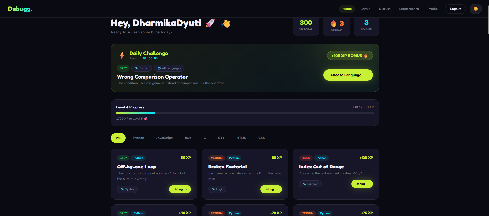
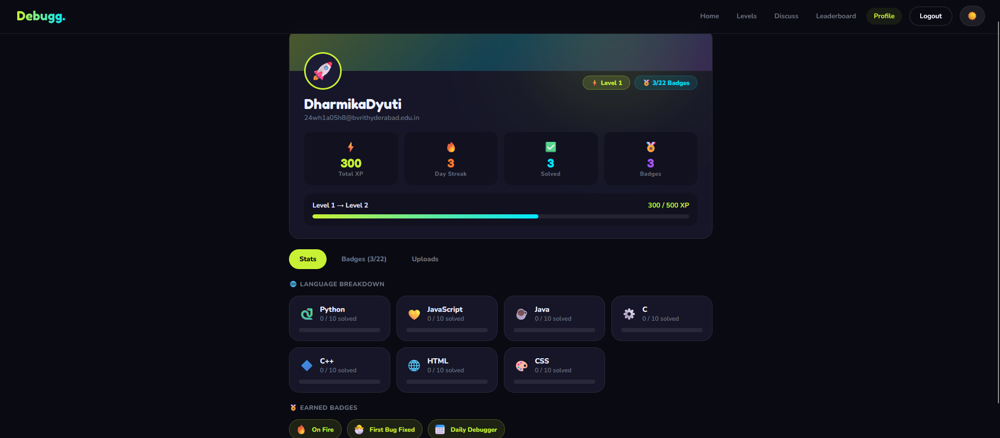
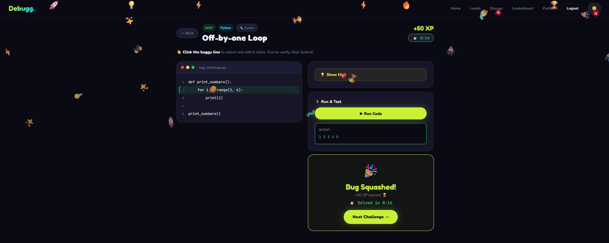
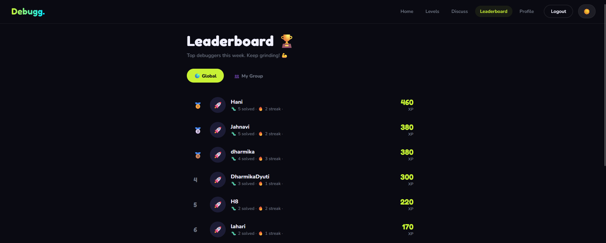
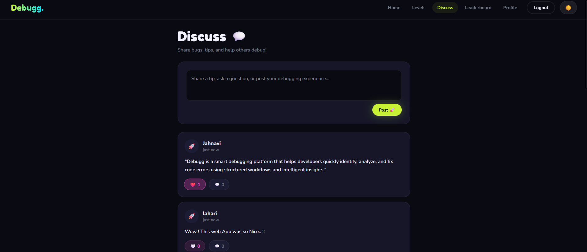
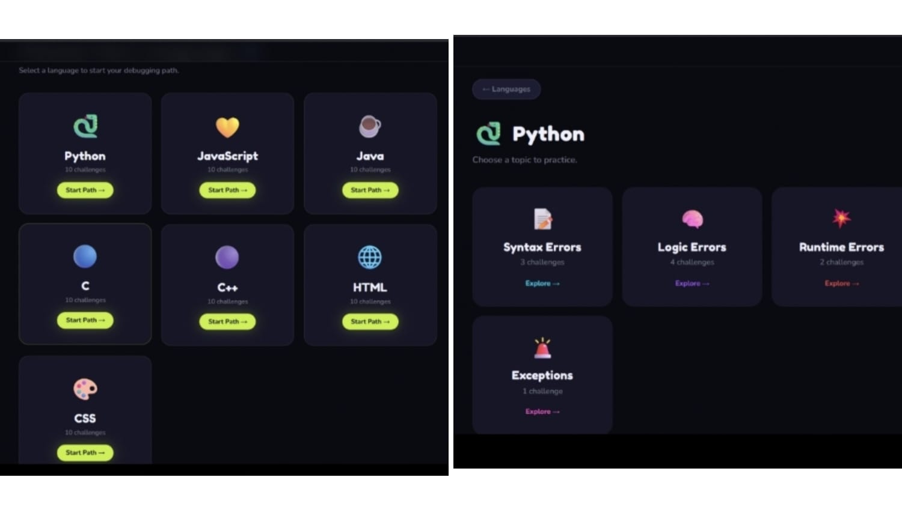

<div align="center">

# 🐛 Debugg

### Learn to code by fixing real, broken code.

**The Duolingo of programming, built for people who want to think like developers.**

[**🚀 Live Demo**](https://debugg-learning-app-po2u.onrender.com) · [Report a Bug](https://github.com/dharmikadyuti/Debugg---Learning-App/issues) · [Request a Feature](https://github.com/dharmikadyuti/Debugg---Learning-App/issues)




</div>

---

## 📖 Table of Contents

- [About](#-about)
- [Features](#-features)
- [Screenshots](#-screenshots)
- [How It Works](#-how-it-works)
- [Tech Stack](#-tech-stack)
- [Getting Started](#-getting-started)
- [Project Structure](#-project-structure)
- [App Pages](#-app-pages)
- [Data Model](#-data-model)
- [Deployment](#-deployment)
- [Roadmap](#-roadmap)
- [Contributing](#-contributing)
- [License](#-license)

---

## 💡 About

Most coding platforms ask you to write code from a blank screen. But in real jobs, developers spend most of their time **reading and fixing** code that already exists.

**Debugg** flips the learning model: you get a buggy snippet, find the problem, apply the fix, run it, and earn XP. Progress through levels across **JavaScript, Python, Java, and HTML**, climb the leaderboard, and learn alongside a community of fellow debuggers.

---

## ✨ Features

| | Feature | Description |
|---|---|---|
| 🐛 | **Debug Real Code** | Fix actual buggy snippets in JavaScript, Python, Java, HTML and more |
| 🎮 | **Levels & XP** | Move through difficulty tiers, unlock new challenges, earn XP per fix |
| 📅 | **Daily Challenge** | A fresh timed challenge every day with a live countdown |
| 🏆 | **Leaderboard** | Compete globally, ranked by XP |
| 🏅 | **Profile & Badges** | Track your stats and collect badges as you improve |
| 💬 | **Community** | Post questions, share tips, comment and like |
| 📝 | **User-Submitted Challenges** | Upload your own challenges for the community |
| 🛠️ | **Dev Dashboard** | Review, approve or reject submissions and publish them as live challenges |
| 🌗 | **Light / Dark Mode** | Full theme toggle across the whole app |
| 🔐 | **Authentication** | Email/password and Google sign-in via Firebase Auth |
| ☁️ | **Realtime Data** | Challenges, users, posts and submissions live in Cloud Firestore |

---

## 🖥️ Screenshots

<table>
  <tr>
    <td width="50%" valign="top" align="center">
      <b>1. Dashboard</b><br/><br/>
      
    </td>
    <td width="50%" valign="top" align="center">
      <b>2. Challenge (Debug View)</b><br/><br/>
      
    </td>
  </tr>
  <tr>
    <td width="50%" valign="top" align="center">
      <b>3. Leaderboard</b><br/><br/>
      
    </td>
    <td width="50%" valign="top" align="center">
      <b>4. Community</b><br/><br/>
      
    </td>
  </tr>
</table>
<p align="center">
  <b>5. Levels</b><br/><br/>
  
</p>
---


## 🔄 How It Works

```
Pick a language  →  Choose a level  →  Read the buggy code  →  Select the faulty line
        →  Apply your fix  →  Run it  →  Submit  →  Earn XP, badges & leaderboard rank
```

1. **Choose** a language, topic and difficulty on the Levels page (or take the Daily Challenge).
2. **Spot** the bug by selecting the faulty line in the debug view.
3. **Fix** it, run the code, and submit.
4. **Level up** — correct fixes award XP, unlock harder challenges, and move you up the leaderboard.

---

## 🧰 Tech Stack

| Layer | Technology |
|---|---|
| **Frontend** | React + TypeScript (functional components & hooks) |
| **Styling** | Custom CSS with Nunito, Fredoka One and JetBrains Mono (Google Fonts) |
| **Auth** | Firebase Authentication (Email/Password, Google OAuth via `signInWithPopup`) |
| **Database** | Cloud Firestore |
| **Backend** | Firebase Cloud Functions (`/functions`) |
| **Hosting** | Render |

---

## 🚀 Getting Started

### Prerequisites

- [Node.js](https://nodejs.org/) v16 or higher
- npm or yarn
- A [Firebase](https://firebase.google.com/) project with **Authentication** and **Firestore** enabled

### 1. Clone the repository

```bash
git clone https://github.com/dharmikadyuti/Debugg---Learning-App.git
cd Debugg---Learning-App
```

### 2. Install dependencies

```bash
npm install
```

### 3. Set up Firebase

In the [Firebase Console](https://console.firebase.google.com/):

- **Authentication** → enable the **Email/Password** and **Google** providers
- **Firestore Database** → create a database (collections are listed in [Data Model](#-data-model))
- **Project Settings** → copy your web app config

Then create a `.env.local` file in the project root:

```env
# Replace the prefix if your setup uses a different one (e.g. VITE_)
REACT_APP_FIREBASE_API_KEY=your_api_key
REACT_APP_FIREBASE_AUTH_DOMAIN=your_project.firebaseapp.com
REACT_APP_FIREBASE_PROJECT_ID=your_project_id
REACT_APP_FIREBASE_STORAGE_BUCKET=your_project.appspot.com
REACT_APP_FIREBASE_MESSAGING_SENDER_ID=your_sender_id
REACT_APP_FIREBASE_APP_ID=your_app_id
```

Your Firebase initialization (`src/firebase.js`) reads from these values:

```js
import { initializeApp } from "firebase/app";
import { getAuth } from "firebase/auth";
import { getFirestore } from "firebase/firestore";

const firebaseConfig = {
  apiKey: process.env.REACT_APP_FIREBASE_API_KEY,
  authDomain: process.env.REACT_APP_FIREBASE_AUTH_DOMAIN,
  projectId: process.env.REACT_APP_FIREBASE_PROJECT_ID,
  storageBucket: process.env.REACT_APP_FIREBASE_STORAGE_BUCKET,
  messagingSenderId: process.env.REACT_APP_FIREBASE_MESSAGING_SENDER_ID,
  appId: process.env.REACT_APP_FIREBASE_APP_ID,
};

const app = initializeApp(firebaseConfig);
export const auth = getAuth(app);
export const db = getFirestore(app);
```

> ⚠️ Never commit `.env.local`. It is already covered by `.gitignore`.

### 4. Deploy Firestore security rules (optional but recommended)

```bash
npm install -g firebase-tools
firebase login
firebase deploy --only firestore:rules
```

### 5. Run the app

```bash
npm start
```

The app will be available at `http://localhost:3000`.

---

## 📁 Project Structure

```
Debugg---Learning-App/
├── public/                 # Static assets
├── src/
│   ├── App.tsx             # Main app and page components
│   ├── firebase.js         # Firebase initialization
│   ├── styles.css          # Global styles
│   └── ...
├── functions/              # Firebase Cloud Functions
├── docs/images/            # README screenshots
├── firebase.json           # Firebase project configuration
├── firestore.rules         # Firestore security rules
├── .firebaserc             # Firebase project alias
├── .eslintrc.json          # ESLint configuration
├── tsconfig.json           # TypeScript configuration
└── package.json
```

---

## 🗺️ App Pages

| Page | Description |
|---|---|
| **Landing** | Hero page with feature highlights and stats |
| **Auth** | Email/password and Google login & sign-up |
| **Dashboard** | Overview of available challenges with filters |
| **Levels** | Language → topic → difficulty selection with unlockable levels |
| **Challenge** | Interactive debug view: select the buggy line, apply a fix, run, submit |
| **Daily Challenge** | Timed challenge with a countdown to the next one |
| **Leaderboard** | Global XP rankings |
| **Discuss** | Community feed: post, comment, like |
| **Profile** | Stats, badges, and a form to submit your own challenge |
| **Dev Dashboard** | Review and publish community-submitted challenges |

---

## 🗄️ Data Model

Debugg stores its data in these Firestore collections:

| Collection | Purpose |
|---|---|
| `users` | Profiles, XP, badges, progress |
| `challenges` | Published debugging challenges |
| `posts` | Community posts, comments and likes |
| `submissions` | User-submitted challenges awaiting review |

---

## ☁️ Deployment

The live app is hosted on **Render**: [debugg-learning-app-po2u.onrender.com](https://debugg-learning-app-po2u.onrender.com)

To deploy your own copy:

1. Push the repo to GitHub.
2. Create a new **Static Site** on [Render](https://render.com) and connect the repo.
3. Set the build command to `npm run build` and the publish directory to `build`.
4. Add your Firebase environment variables in Render's dashboard.
5. In Firebase Console → Authentication → Settings → **Authorized domains**, add your Render domain so Google sign-in works.

> The free Render tier may spin down when idle, so the first load can take a few seconds.

---

## 🛣️ Roadmap

- [x] Multi-language debugging challenges
- [x] XP, levels and global leaderboard
- [x] Daily challenge with countdown
- [x] Community discussion feed
- [x] User-submitted challenges with a moderation dashboard
- [x] Light / dark theme
- [ ] Support for more programming languages
- [ ] Streaks and achievement milestones
- [ ] More advanced debugging challenges
- [ ] Personalized challenge recommendations based on performance
- [ ] Automated challenge validation
- [ ] Unit and end-to-end tests

---

## 🤝 Contributing

Contributions are welcome, whether it's a new challenge, a bug fix, or a feature idea.

1. Fork the project
2. Create your branch: `git checkout -b feature/amazing-feature`
3. Commit your changes: `git commit -m "Add amazing feature"`
4. Push to the branch: `git push origin feature/amazing-feature`
5. Open a Pull Request

You can also [open an issue](https://github.com/dharmikadyuti/Debugg---Learning-App/issues) to discuss ideas first.

---

## 📄 License

No license has been added yet. Consider adding one (for example [MIT](https://choosealicense.com/licenses/mit/)) so others know how they can use this project.

---

## 👤 Author

**Dharmika Dyuti**
GitHub: [@dharmikadyuti](https://github.com/dharmikadyuti)

<div align="center">

If you like Debugg, give it a ⭐ — it really helps!

</div>
